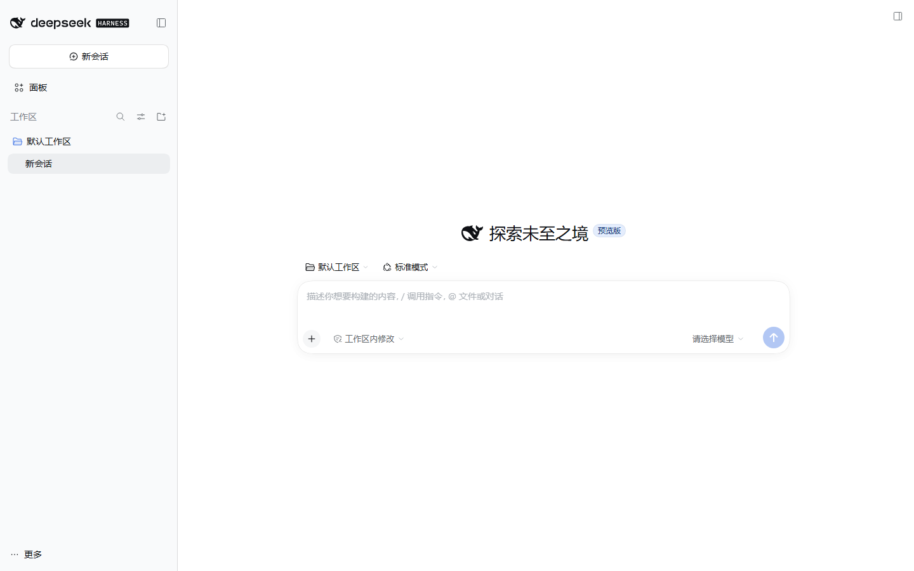
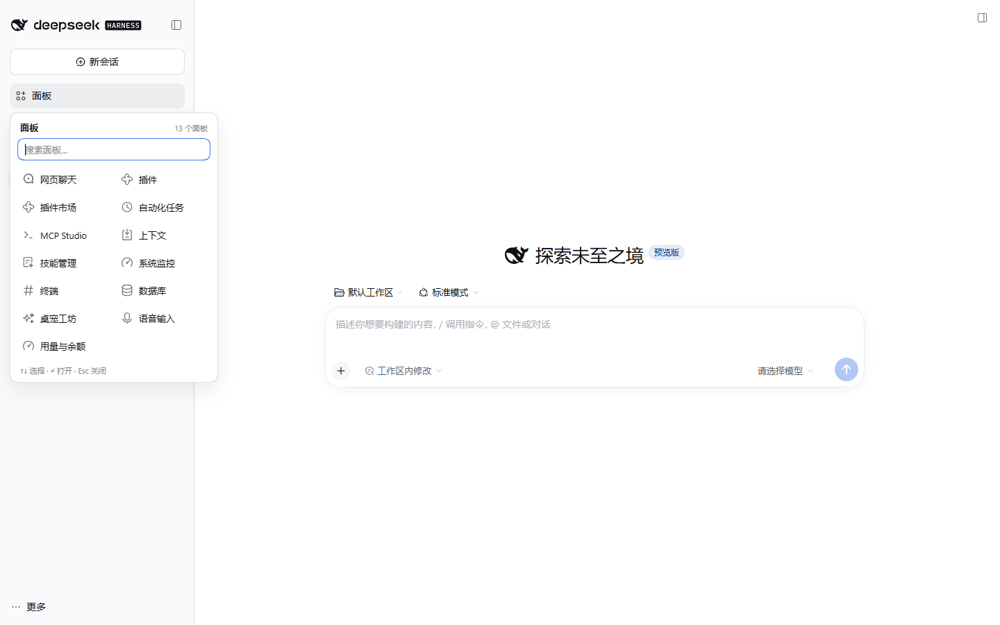
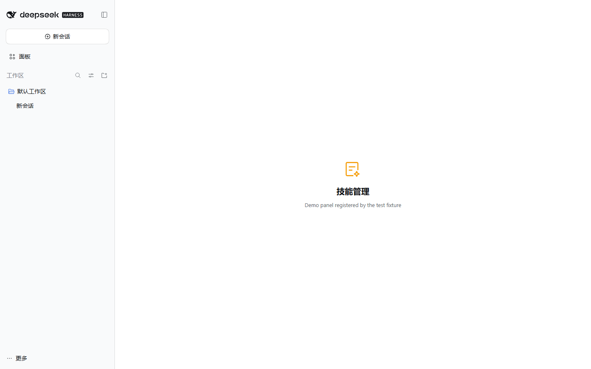
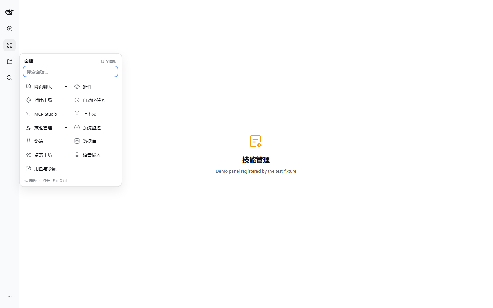
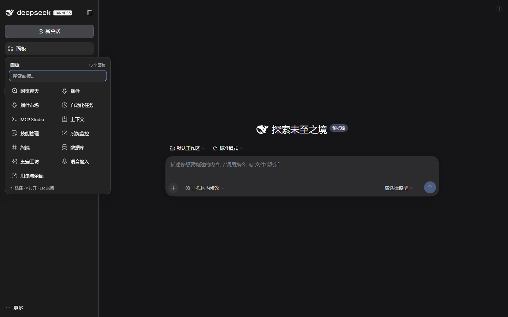

# dsh-sidebar-shelf

**Give the DSH sidebar back its space.** Every left-sidebar panel entry folds into one quiet shelf that sits exactly where the panels used to be — above the workspace. Open a panel only when you need it.

[English](README.md) | [简体中文](README.zh-CN.md)

[](https://github.com/topics/dsh-plugin)
[](LICENSE)





## Why

The DSH Web/desktop sidebar stacks its brand row, **New Session**, **every global panel entry**, the workspace list, and Settings. Each plugin that adds a panel adds a row to that column — plugin manager, plugin market, schedules, MCP studio, context, skills, system monitor. Ten rows is roughly 400px, and the workspace area is squeezed to a couple of conversations.

`dsh-sidebar-shelf` folds **all panel entries** into a single row in that same column, right above the workspace, and brings any panel back on demand.

- **One row where the panel list was.** Same place, same width, same spacing as a native panel row — the workspace moves straight up under it.
- **Adopts injected entries.** Plugins that bypass the slot and inject a row straight into the sidebar (the `data-dsh-*-entry` convention used by `dsh-webchat`, taskboard and ssh) are hidden in place and listed in the same shelf with their own icon, label and active state; choosing one clicks their own button, so their toggle keeps working.
- **A native row, not a fake one.** The shell's own button, hover state, 36px rail form and tooltip are reused; only the sibling rows are hidden.
- **A 2-column shelf** with each panel's own registered icon.
- **Search** appears once there are more than seven panels.
- **Keyboard first**: `↑`/`↓` to move, `Enter` to open, `Esc` to close, and plain typing filters.
- **Rail aware**: in the 56px sidebar rail the row is still the shell's 36px icon and the shelf opens beside the rail, not on top of it.
- **Theme aware**: only `--dsw-alias-*` / `--dsw-radius-*` / `--dsw-shadow-*` tokens; follows light and dark themes.

| Panel open | Rail | Dark |
| --- | --- | --- |
|  |  |  |

## Install

Requires DSH (DeepSeek Harness) with the `web` profile — the desktop app uses the same client.

```sh
# straight from GitHub (no build step, no allowBuilds approval)
dsh plugin --profile desktop add github:wumouren114/dsh-sidebar-shelf

# or from a local clone
git clone https://github.com/wumouren114/dsh-sidebar-shelf.git
dsh plugin --profile desktop add ./dsh-sidebar-shelf
```

`desktop` is the profile name in this repository's examples; substitute `web`, `tui`, or whatever profile you run. After installing, enable the plugin in **Settings → Plugins** (it is added to `dsh.profile.bundles`) and reload the page.

**Verify:** the whole panel column becomes one **Panels** row between **New Session** and **工作区 / Workspace**. Click it — every registered panel is there, including "Plugins". Picking one opens it and closes the shelf.

> This package ships a hand-written `lib/client.js`: there is no `prepare`/`postinstall` script, so a GitHub install never stops at pnpm's `ERR_PNPM_GIT_DEP_PREPARE_NOT_ALLOWED` or `ERR_PNPM_IGNORED_BUILDS`.

Requirements: DSH 0.2.x client, Node.js ≥ 20 for the CLI that installs it.

## How it works

DSH's left sidebar is owned by `@deepseek-ai/dsh-client-ui-sidebar`. Third-party plugins cannot re-declare that list, but the shell publishes a small, stable contract:

| Contract | Use |
| --- | --- |
| `sidebar.panellist` slot (root scope, list) | Every panel registers an icon component with `id` / `order` / `label`. The shelf registers one entry of its own here (`order: -1000`) and reads the rest of the registry as its data source. |
| The registered row's DOM | The shell wraps our icon in its own `<button class="panelRow">`. From the glyph we find that button, mark it `data-dsh-shelf-row` and intercept its click in the capture phase. |
| `ctx.layout.selectPanel(id)` | The official way to open a panel; the shelf never fakes a click on another row. |
| `ctx.layout.panelInfo` | The selected-panel source, used for the active marker inside the shelf. |

Concretely, `lib/client.js`:

1. registers its own `sidebar.panellist` entry (`id: dsh-sidebar-shelf-entry`, `order: -1000`, label `面板` / `Panels`);
2. from its glyph walks to the shell's row button, marks it, and attaches a capture-phase click handler — this both opens the shelf and stops the shell from calling `selectPanel` on an id that has no main panel;
3. hides the sibling rows with one scoped rule: `[data-dsh-shelf="on"] > nav > *:not([data-dsh-shelf-row]) { display: none !important }` — the list element itself stays mounted, so the row keeps the shell's native position, spacing and rail geometry;
4. also watches the sidebar root for rows injected by other plugins (`data-dsh-*-entry`), hides them in place and lists them at the top of the shelf with their own icon, label and `data-active` state; choosing one calls that row's own `click()`;
5. reads `ctx.slots.entriesOfSlot("sidebar.panellist")` for the remaining shelf contents, mirrors the sidebar's own sort (`order`, then registration order), and renders each panel's **own** icon component (wrapped in an error boundary that falls back to an initial);
6. calls `ctx.layout.selectPanel(id)` when a registered panel tile is chosen.

Nothing else is touched: no workspace rows, no brand row, no Settings, no host-side behavior, no DSH files. Unmounting the plugin removes the marker, the handler and the stylesheet, and the native rows come back.

## Verified

- DSH `0.2.1-rc.3`, Windows, Chromium 1440×900 — 23/23 end-to-end checks: placement above the workspace, sibling-only hiding, search, keyboard, panel switching, active marker, Escape, adoption of a DOM-injected `data-dsh-*-entry` row (hidden in place, listed first, own click handler runs, active state reflected), 56px rail, dark theme, no page errors.
- `node test/smoke.mjs` — 10 manifest/bundle/wiring checks, no dependencies.

The screenshots above were produced by `test/e2e.cjs` against a throwaway profile; the panels in them come from a test-only fixture (`test/demo-panels`), not from shipped code.

## Known limitations

- **Every other panel row is hidden**, including the shell's own "More" menu (`Browse other plugins` / `Create your plugin`). The Plugins panel is still one click away in the shelf.
- **Injected rows are adopted only when they follow the `data-dsh-*-entry` convention** (as `dsh-webchat`, taskboard and ssh do). A plugin that injects a row without that marker stays in the sidebar.
- One plugin, one job: there is no per-panel pin/hide policy yet. If you need "keep these three in the sidebar", say so in an issue — it is the natural next step.
- Do not pair it with another plugin that hides the same list (e.g. `dsh-toomuch-plugins`, `dsh-sidebar-organizer`); pick one.
- The DOM contract is the shell's panel-row button inside the list. If a future DSH release changes that structure, the worst case is an un-hidden list, never a broken sidebar.

## Development

```sh
node test/smoke.mjs                  # static + wiring checks, no browser
node test/e2e.cjs <dsh-web-url>     # real UI checks + screenshots (needs puppeteer-core)
```

`test/e2e.cjs` expects `NODE_PATH` to point at a `node_modules` that contains `puppeteer-core`, and a Chromium/Edge binary (override with `DSH_SHOT_BROWSER`). The repo has no build step: `lib/client.js` is the shipped bundle.

## License

MIT © wumouren114 — see [LICENSE](LICENSE).
