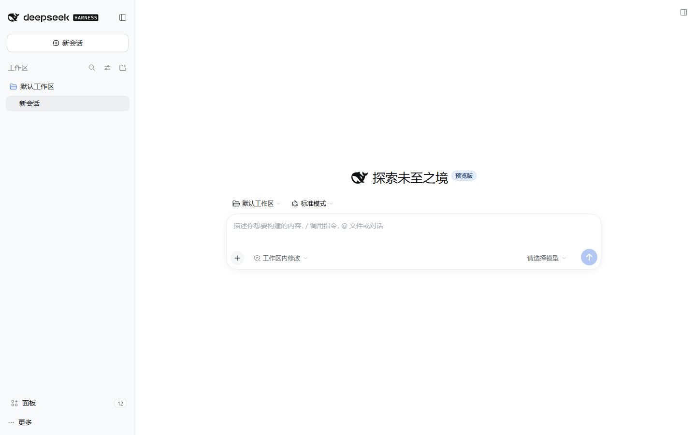
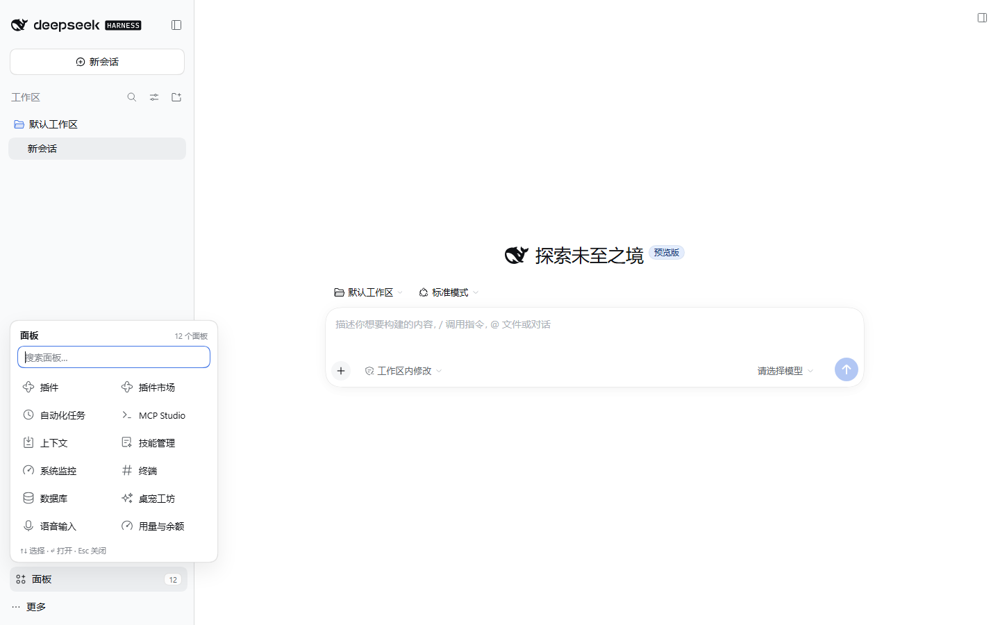
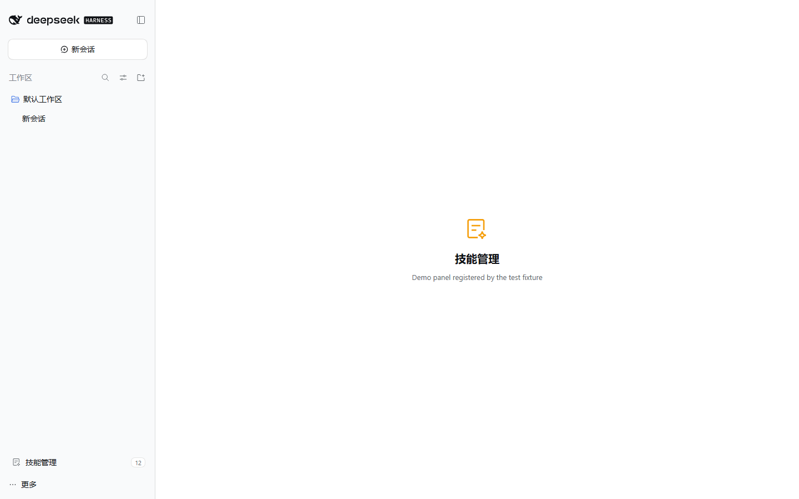
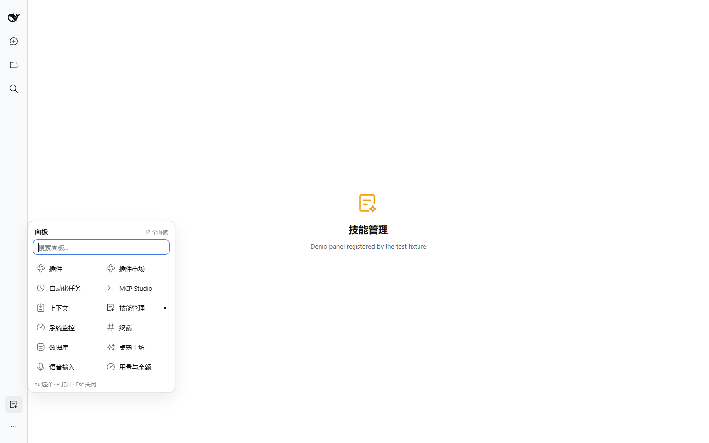
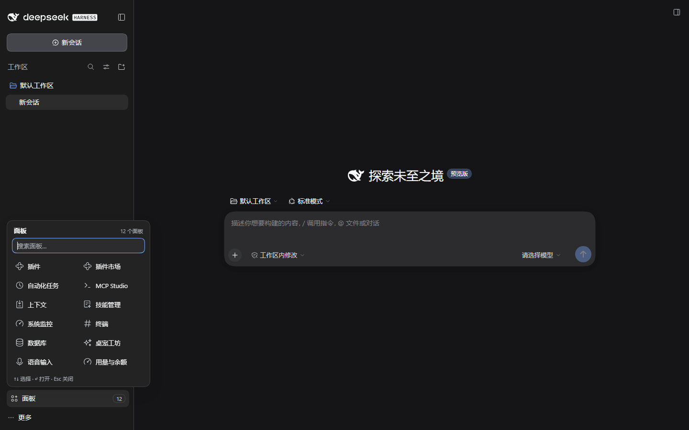

# dsh-sidebar-shelf · 侧栏收纳架

**把 DSH 左侧栏的空间还回来。** 所有面板入口收进侧栏底部的一个收纳架，需要某个面板时再展开。

[English](README.md) | [简体中文](README.zh-CN.md)

[](https://github.com/topics/dsh-plugin)
[](LICENSE)





## 为什么

DSH Web / 桌面端的左侧栏从上到下是：品牌行 → **新会话** → **每个全局面板入口** → 工作区 → 设置。每装一个带面板的插件，这一列就多一行：插件、插件市场、定时任务、MCP Studio、上下文、技能管理、系统监控…… 十行大约 400px，工作区被挤得只剩两三个会话。

`dsh-sidebar-shelf` 只做一件事：**把所有面板入口收起来**，只留侧栏底部的一个收纳架，想用哪个再展开。

- **一行代替 N 行**，侧栏立刻清爽。
- **两列面板架**，每个面板用它自己注册的图标和名字。
- **面板超过 7 个自动出现搜索框**。
- **键盘优先**：`↑`/`↓` 移动、`Enter` 打开、`Esc` 关闭，直接打字就是过滤。
- **当前在哪**：打开某个面板后，收纳架那一行会变成该面板的图标和名字，侧栏仍然告诉你当前位置。
- **窄栏适配**：侧栏收成 56px 轨道时，收纳架变成 36px 图标按钮，并且**在轨道右侧展开**，不盖住轨道。
- **跟随主题**：只用 `--dsw-alias-*` / `--dsw-radius-*` / `--dsw-shadow-*` 主题变量，明暗主题都一致。

| 打开面板后 | 56px 轨道 | 暗色主题 |
| --- | --- | --- |
|  |  |  |

## 安装

需要带 `web` profile 的 DSH（DeepSeek Harness）——桌面端用的是同一套客户端。

```sh
# 直接从 GitHub 安装（无构建步骤，不需要 allowBuilds 授权）
dsh plugin --profile desktop add github:wumouren114/dsh-sidebar-shelf

# 或者从本地 clone
git clone https://github.com/wumouren114/dsh-sidebar-shelf.git
dsh plugin --profile desktop add ./dsh-sidebar-shelf
```

`desktop` 只是示例 profile 名，换成你实际运行的 `web`、`tui` 等即可。装完后在 **设置 → 插件** 里启用它（会写进 `dsh.profile.bundles`），刷新页面。

**验证方式：** 侧栏的面板列消失，「设置」上方多出一行 **面板**，右侧带数量角标。点它——所有已注册面板都在里面（包括「插件」）。选一个即打开，收纳架自动关闭。

> 本包直接提交手写的 `lib/client.js`，**没有 `prepare` / `postinstall` 脚本**，所以从 GitHub 安装不会卡在 pnpm 的 `ERR_PNPM_GIT_DEP_PREPARE_NOT_ALLOWED` 或 `ERR_PNPM_IGNORED_BUILDS`。

环境要求：DSH 0.2.x 客户端；安装它的命令行需要 Node.js ≥ 20。

## 实现原理

DSH 的左侧栏由 `@deepseek-ai/dsh-client-ui-sidebar` 拥有。第三方插件不能重新声明或重排这个列表，但外壳公开了一组稳定契约：

| 契约 | 用途 |
| --- | --- |
| `sidebar.panellist` 槽（root 作用域，list） | 每个面板在这里注册 `id` / `order` / `label` 和图标组件；收纳架把它当作唯一事实来源。 |
| `sidebar.footer.action` 槽（root 作用域，list） | 收纳架入口挂在「设置」旁边。 |
| `ctx.layout.selectPanel(id)` | 官方选中面板的方式；收纳架从不伪造点击。 |
| `ctx.layout.panelInfo` | 当前选中面板，用于「当前」标记和入口的「你在哪」显示。 |

具体到 `lib/client.js`：

1. 读 `ctx.slots.entriesOfSlot("sidebar.panellist")`，并复刻侧栏自己的排序（`order`，再按注册顺序）；
2. 从自己的 footer 节点向上找到侧栏根节点（那个直接子节点是 `<nav>` 的元素），只给它设一个属性；
3. 用一条作用域受限的规则隐藏那个 `<nav>`：`[data-dsh-shelf="on"] > nav { display: none !important }`；
4. 在 portal 里渲染收纳架，每个格子直接用面板**自己注册的图标组件**（外层错误边界，失败时退回首字母）；
5. 选中格子时调用 `ctx.layout.selectPanel(id)`。

其它什么都不碰：不动工作区、品牌行、设置，不加宿主行为，也不改 DSH 的任何文件。插件卸载时属性与样式一起移除，原生面板列自动回来。

## 已验证

- DSH `0.2.1-rc.3` / Windows / Chromium 1440×900 —— 17/17 端到端检查通过，覆盖明色、暗色、56px 轨道。
- `node test/smoke.mjs` —— 10 项清单 / bundle / 接线检查，零依赖。

上面的截图由 `test/e2e.cjs` 在一次性测试 profile 里产生；截图里的面板来自仅用于测试的 fixture（`test/demo-panels`），不随包发布。

## 已知限制

- **原生面板列整体隐藏**，包括内置的「更多」菜单（浏览更多插件 / 创建你的插件）。「插件」面板仍在收纳架里一步可达。
- 一个插件只做一件事：暂时没有「固定某几个面板留在侧栏」的策略。需要的话请开 issue，这是 v0.2 最自然的方向。
- 不要和另一个同样隐藏该列表的插件（如 `dsh-toomuch-plugins`、`dsh-sidebar-organizer`）同时使用，二选一。
- DOM 契约是「侧栏根节点的直接子 `<nav>`」。如果未来 DSH 改了结构，最坏情况是列表没被隐藏，而不会把侧栏弄坏。

## 开发

```sh
node test/smoke.mjs                  # 静态 + 接线检查，不需要浏览器
node test/e2e.cjs <dsh-web-url>     # 真实 UI 检查 + 截图（需要 puppeteer-core）
```

`test/e2e.cjs` 要求 `NODE_PATH` 指向含 `puppeteer-core` 的 `node_modules`，并准备 Chromium / Edge（可用 `DSH_SHOT_BROWSER` 覆盖）。仓库没有构建步骤：`lib/client.js` 就是发布产物。

## 许可证

MIT © wumouren114 —— 见 [LICENSE](LICENSE)。
